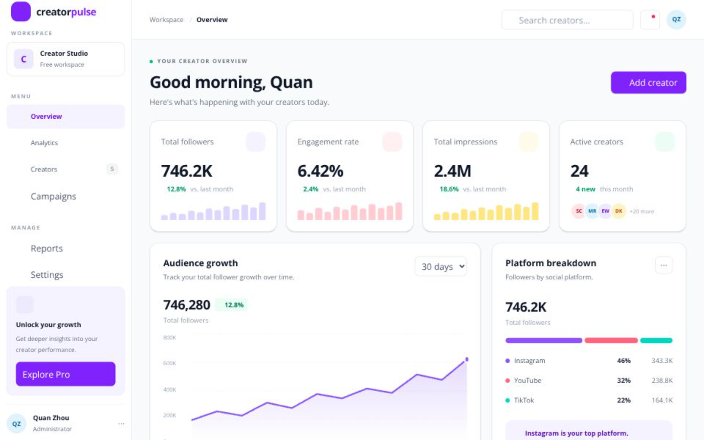

# CreatorPulse

A creator analytics dashboard for tracking social media creators across Instagram, YouTube and TikTok.

**Live demo:** https://creator-pulse-nine.vercel.app/



## Overview

CreatorPulse is a portfolio project that shows how I build a production-style frontend feature end to end: typed data models, an API layer, server-state management, accessible forms, and responsive layouts.

## Features

- **Dashboard overview** – summary stat cards and a growth chart
- **Creators table** – search by name or handle, filter by platform, sort by followers / engagement / growth, and paginate results
- **Add creator** – modal form with client- and server-side validation, duplicate detection per platform, pending and error states
- **Server state with TanStack Query** – cached queries, mutations, and automatic table refresh after a creator is added
- **Loading, empty and error states** – including a retry action when the API request fails
- **Responsive and accessible UI** – works from mobile to desktop, with labelled inputs, ARIA roles and keyboard-friendly dialogs

## Tech stack

- [Next.js](https://nextjs.org/) (App Router)
- TypeScript
- Tailwind CSS
- TanStack Query
- Next.js Route Handlers as a mock REST API

## Project structure

```
app/
  api/creators/route.ts   # GET and POST endpoints (mock API)
  page.tsx                # Dashboard page
components/
  dashboard/              # StatCard, CreatorsTable, AddCreatorModal, ...
lib/
  api/creators.ts         # Typed API client (getCreators, createCreator)
  mock-data.ts            # Seed data
  utils.ts
types/
  creator.ts              # Shared domain types
```

## Getting started

```bash
yarn install
yarn dev
```

Open [http://localhost:3000](http://localhost:3000).

Other scripts:

```bash
yarn lint
yarn build
```

## Implementation notes

- **API validation:** the `POST /api/creators` handler validates the request body, normalizes the handle (strips a leading `@`, case-insensitive comparison), and returns `400` for invalid input, `409` for duplicates and `201` on success.
- **Mutation flow:** the modal awaits the mutation result. The form only resets on success; on failure it stays open and shows the error returned by the API.
- **Demo data:** new creators are stored in server memory, so they reset when the server restarts. In a production version this would be replaced with a database.

## Roadmap

- Persist creators in a database
- Content and analytics pages
- Date range filters for charts
